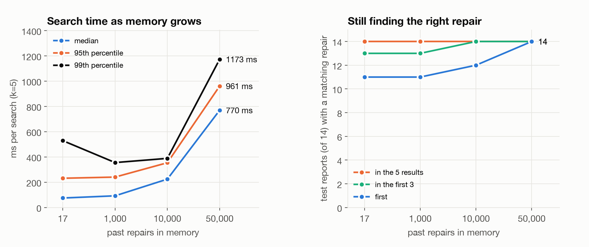
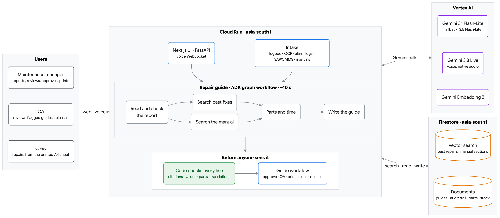

# PlantMemory

In a pharma plant, when a machine stops, the workers wait. They escalate to the
maintenance manager, and the line stays down until the manager decides what to do and
tells them. Workers usually can't carry phones on the floor, and the knowledge the
manager needs is scattered across breakdown logbooks, SAP history, equipment manuals and
people's memories.

PlantMemory is built for that manager. Describe the breakdown by typing, by speaking in
any Indian language, from a logbook photo or straight from the machine's alarm log, and
it drafts a **repair guide**:

- steps from the equipment manual's procedure, plus what fixed it before in this plant,
  each step citing its source;
- a warning when this problem keeps coming back or when last time's fix didn't hold;
- the spare parts to collect, with stock and bin location from the store, and a flag
  when a part is short;
- a time estimate from the manual and past downtime.

The manager checks the AI's draft, changes anything by saying or typing it ("step 6 is
for the engineer, not the operator", in any language), and approves it; QA must approve
first only when code finds a reason (a value not in the manual, a step with no source, a
translation that may not match, an earlier rejection). The manager then prints it for the
workers as an A4 controlled copy in English plus the languages the crew reads (Telugu and
Hindi by default; any of 12 Indian languages can be added), with the manual's figures and
tick boxes.
When the repair is done, the manager says what was done (a short "did what the guide
said" is enough; the app asks only what the guide can't tell it) and it is saved to plant
memory. QA then does the line clearance and releases the machine to production.

Voice is a live conversation on Gemini Live (`gemini-3.8-live`): it starts answering in
the manager's language within about 2 seconds of them stopping (under one second in a
direct test), and the manager can talk over it.

## How it performs

Measured 14 Oct 2026 with `gemini-3.1-flash-lite` (`make benchmark`, `make eval`):

| What | Result |
|---|---|
| Time to a finished, checked repair guide | **9.3 s** median, 18.3 s p95 (16 of 16 drafted) |
| Eight managers drafting at the same moment | 8 of 8 guides, the slowest in 14.5 s, no errors |
| Gemini cost per guide, with its Telugu and Hindi translation | **about $0.008** (under ₹1) |
| A spoken breakdown report on Gemini Live | about $0.01; the reply starts under a second after the manager stops |
| Right machine, alarm code and manual found | 16 of 16 |
| Repair steps citing a manual page or a past fix | 101 of 112 (the rest are marked "general practice") |
| Recognising a repeat breakdown | 13 of 14 right, **0 of 11 false alarms** (0 of 6 look-alikes) |
| Machine with no manual given another machine's manual | 0 of 7 (7 of 7 by search score alone) |
| Faults planted in guides and translations, caught by code | **333 of 333** |
| Part numbers Gemini alone gives that exist in the store | 0 of 28; PlantMemory's come only from the store |


Where the time goes in one guide: understanding the report, searching plant memory and
the manuals side by side, then writing the guide and checking every line in code.


Time to a finished, checked guide for the kinds of reports a manager gives: an alarm
code, Telugu, Hindi, a two-word report, a vague one, and a machine with no manual.


The same breakdowns, the same model: Gemini on its own invents part numbers and
settings; PlantMemory's parts come from the store and its values from cited sources.



A plant group's memory would hold tens of thousands of repairs, not 17. `make
scale-benchmark` fills separate Firestore collections with up to 50,000 real FDA device
repair reports plus the 17 demo records, then searches them the way the app does (17 Oct
2026, from a laptop in India to Firestore in Mumbai). A search takes 75 ms at 17 records,
224 ms at 10,000 and 770 ms at 50,000 (median). Among 50,000, many FDA reports describe the
same fault as a test report, so every record a search showed was read and judged
([`data/eval/scale_judgements.json`](data/eval/scale_judgements.json)). At 50,000 the first
result is a matching repair for 14 of the 14 test reports. After Gemini's check, the first
match shown is right for 13 of 14 at every size, with 1 false alarm in 11 at 50,000 (0 at 17).

Built for the Google Cloud AI Builder Cup (APAC) with Gemini, the Agent Development Kit,
Firestore vector search and Cloud Run.

## Architecture



One Cloud Run service serves the API, the UI and the voice WebSocket. Drafting a guide
is an **ADK graph Workflow** (`app/guide/flow.py`): the report is read and checked side by
side, a decision node either asks the manager one question (wrong machine, nothing said
about what failed) or routes on, past fixes and the manual are searched side by side, then
parts and the guide are written. The order is fixed by the graph rather than chosen by a
model, so a guide takes about 10 seconds and every run takes the same path; each node has a
timeout and the searches retry once on a transient error. Every step is a plain function
tested without ADK, and code checks the written guide before anyone sees it. Redraw the
diagram with `uv run --with playwright python -m scripts.make_architecture --png`.

> **Past repairs are real; plant-private data is invented.** Plant memory starts with 17
> real steam sterilizer repairs from FDA device reports (public domain), each linked to its
> source and used as "at another site", never as this plant's history. Manuals, parts,
> stock, SAP rows, machine logs and logbook photos are invented stand-ins, because no plant
> publishes them. See [data/SOURCES.md](data/SOURCES.md).

## What's in it

| Screen | What the manager does |
|---|---|
| Breakdown | See at a glance which machines are running, stopped (and for how long) or waiting for QA's release. Type, or talk it through by voice (it asks for what's missing and reads the report back), or read a logbook photo. Get a cited repair guide; a machine with an open guide is flagged so one stop isn't drafted twice. A report that names another machine than the one picked, or says nothing about what failed, gets one question instead of a guess. |
| Alarm logs | Upload an HMI alarm export or controller log. Errors that stopped the machine come first with the manual's first actions and time; rising warnings are flagged. One click drafts the guide. |
| Guides | Every guide from draft to approval, printing, closure and QA release, with a track showing the stage and an audit trail. A guide that isn't needed is withdrawn with a reason, never deleted. Change a draft by voice or typed, in any language; every change is marked and checked before it is kept. QA reviews and releases here. |
| Memory | Past incidents, equipment manuals by page, spare parts and stock. **Add records** brings in logbook photos, SAP PM / CMMS exports (CSV or Excel) and equipment manual PDFs. |

## Rules enforced in code, not left to the model

- A guide may only cite the past incidents and manual sections it was given; anything
  else is removed and flagged. A line with no source is labelled "general practice".
- A value with a unit (25 Nm, 121 °C, 8 to 10 mm) must appear in a source the line cites,
  or the line is flagged for the manager and QA.
- Parts must exist in the store; stock, bin and lead time come from the store.
- Times come from the manual and past downtime, never from the model.
- Each translation is checked: every number, part number, alarm code and machine tag in
  the English must appear in every translation, or the line is flagged. A language
  added after approval with a flagged line is not printed.
- The manager may approve a guide only when every line cites a source, no value is
  flagged and every translation kept its numbers and codes; otherwise approving sends it
  to QA with the reasons. The manager can't send a guide to QA or skip QA by choice, and
  a guide QA sent back goes back to QA. Every closed repair goes to QA for release.
  `QA_APPROVAL=always` makes QA approve every guide.
- A machine counts as stopped from its first open guide until QA releases it. A guide
  withdrawn as not needed must give a reason, and one with a printed copy can't be
  withdrawn (the repair is closed instead).
- QA can't approve a guide they sent; a rejection needs a reason; only approved guides
  print, and every printed copy is numbered and logged. The person who closed a repair
  can't release the machine; release needs every line-clearance check ticked.
- Voice: code decides what is still missing and when the report is complete; the model
  only fills fields and talks. "Did what the guide said" doesn't count as an answer
  until it is expanded from the guide.
- A report that names no machine gets a manual only when Gemini confirms the manual is
  for that equipment; a coating pan never gets the tablet press's steps.
- If Gemini is out of capacity after retries, the call is answered by a fallback model and
  goes through the same checks.
- Matches from plant memory are checked by Gemini before they count.
- Repairs from other sites (public records) show what fixed a problem elsewhere; they never
  count as repeats on this plant's machines.

## Quick start

Requires [uv](https://docs.astral.sh/uv/) and pnpm.

```bash
cp .env.example .env   # add a Gemini API key or Vertex AI settings
make install
make seed seed-kb      # real past repairs, then (stand-in) manuals, alarm codes, parts, figures
make run               # http://localhost:8473, API docs at /docs
make test
```

Sample files to try are in `data/samples/`: an HMI alarm log and a controller log, an SAP
IW29 export, a fluid bed dryer manual PDF and two logbook photos. Each screen has
"try a sample" buttons.

The plant type in the prompts is a setting: `PLANT_TYPE="paper mill"` (default
"pharmaceutical plant"). Nothing else is industry-specific.

The manager sets the floor languages (what the crew reads, up to 3) from the header;
every guide is translated into them on approval. `GUIDE_LANGUAGES='["te","hi"]'` is the
default until then. English is always printed, with at most 3 languages under it
(`MAX_SHEET_LANGUAGES`). On the print page the manager can add Assamese, Bengali,
Gujarati, Hindi, Kannada, Malayalam, Marathi, Odia, Punjabi, Tamil, Telugu or Urdu.

**Test every feature step by step:** [docs/TESTING.md](docs/TESTING.md) (what to do, what
you should see, and why it matters on the floor). Deploying, and seeing who used it and
what broke (`make visits`, Cloud Error Reporting, Google Analytics):
[docs/DEPLOY.md](docs/DEPLOY.md#seeing-who-used-it-and-what-broke).
