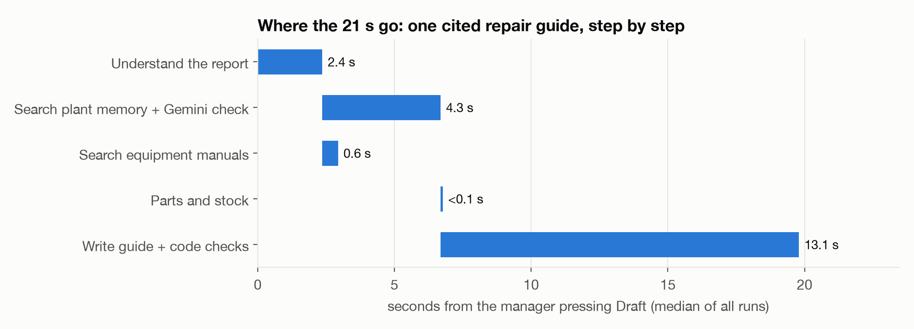
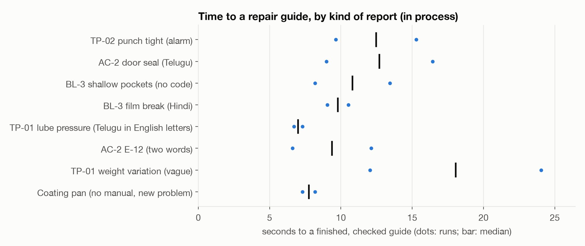
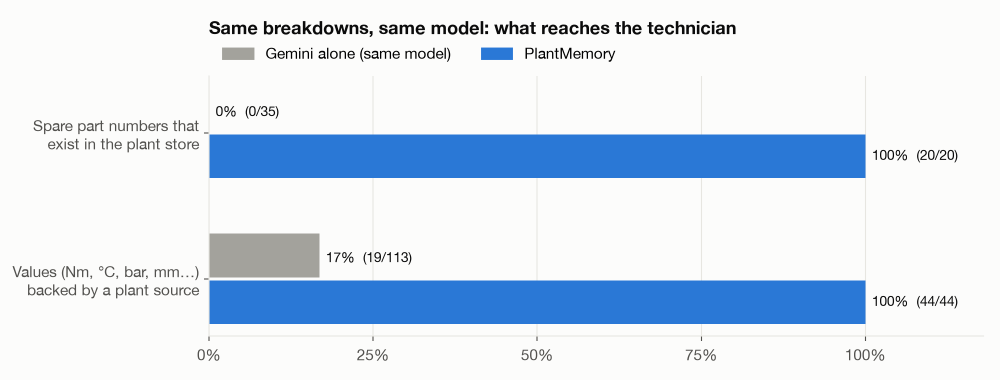
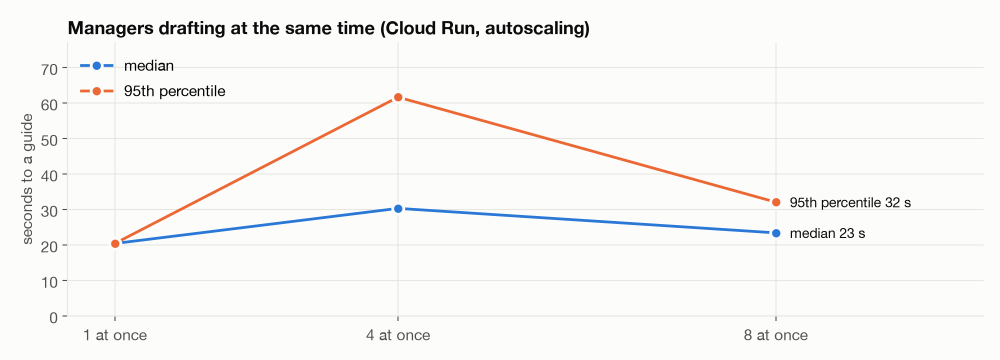

# PlantMemory

In a pharma plant, when a machine stops, the workers wait. They escalate to the
maintenance manager, and the line stays down until the manager decides what to do and
tells them. Workers usually can't carry phones on the floor, and the knowledge the
manager needs is scattered across breakdown logbooks, SAP history, equipment manuals and
people's memories.

PlantMemory is built for that manager. Describe the breakdown by typing, by speaking in
any Indian language, from a logbook photo or straight from the machine's alarm log, and
it drafts a **repair guide**:

- steps from the equipment manual's procedure, plus what fixed it before in this plant,
  each step citing its source;
- a warning when this problem keeps coming back or when last time's fix didn't hold;
- the spare parts to collect, with stock and bin location from the store, and a flag
  when a part is short;
- a time estimate from the manual and past downtime.

The manager checks the AI's draft and approves it; QA must approve first only when code
finds a reason (a value not in the manual, a step with no source, a translation that may
not match, an earlier rejection). The manager then prints it for the workers as an A4
controlled copy in English, Telugu and Hindi, with the manual's figures and tick boxes.
When the repair is done, the manager says what was done (a short "did what the guide
said" is enough; the app asks only what the guide can't tell it) and it is saved to plant
memory. QA then does the line clearance and releases the machine to production.

Voice is a live conversation on Gemini Live (`gemini-3.8-live`): it starts answering in
the manager's language about 2 seconds after they stop talking, and the manager can talk
over it.

## How it performs



Where the time goes in one guide: understanding the report, searching plant memory and
the manuals side by side, then writing the guide and checking every line in code.



Time to a finished, checked guide on Cloud Run for the kinds of reports a manager gives:
an alarm code, Telugu, Hindi, a two-word report, and a machine with no manual.



The same breakdowns, the same model: Gemini on its own invents part numbers and
settings; PlantMemory's parts come from the store and its values from cited sources.



Several managers drafting at once: Cloud Run scales out and guides still arrive in
about the same time.

Built for the Google Cloud AI Builder Cup (APAC) with Gemini, the Agent Development Kit,
Firestore vector search and Cloud Run.

> **Past repairs are real; plant-private data is invented.** Plant memory starts with 17
> real steam sterilizer repairs from FDA device reports (public domain), each linked to its
> source and used as "at another site", never as this plant's history. Manuals, parts,
> stock, SAP rows, machine logs and logbook photos are invented stand-ins, because no plant
> publishes them. See [data/SOURCES.md](data/SOURCES.md).

## What's in it

| Screen | What the manager does |
|---|---|
| Breakdown | Type, or talk it through by voice (it asks for what's missing and reads the report back), or read a logbook photo. Get a cited repair guide. |
| Alarm logs | Upload an HMI alarm export or controller log. Errors that stopped the machine come first with the manual's first actions and time; rising warnings are flagged. One click drafts the guide. |
| Guides | Every guide from draft to approval, printing, closure and QA release, with an audit trail. QA reviews and releases here. |
| Memory | Past incidents, equipment manuals by page, spare parts and stock. |
| Add records | Logbook photos, SAP PM / CMMS exports (CSV or Excel), equipment manual PDFs. |

## Rules enforced in code, not left to the model

- A guide may only cite the past incidents and manual sections it was given; anything
  else is removed and flagged. A line with no source is labelled "general practice".
- A value with a unit (25 Nm, 121 °C, 8 to 10 mm) must appear in a source the line cites,
  or the line is flagged for the manager and QA.
- Parts must exist in the store; stock, bin and lead time come from the store.
- Times come from the manual and past downtime, never from the model.
- Each translation is checked: every number, part number, alarm code and machine tag in
  the English must appear in the Telugu and Hindi, or QA sees a flag.
- The manager may approve a guide only when every line cites a source, no value is
  flagged and every translation kept its numbers and codes; otherwise it goes to QA with
  the reasons. `QA_APPROVAL=always` makes QA approve every guide.
- QA can't approve a guide they sent; a rejection needs a reason; only approved guides
  print, and every printed copy is numbered and logged. The person who closed a repair
  can't release the machine; release needs every line-clearance check ticked.
- Voice: code decides what is still missing and when the report is complete; the model
  only fills fields and talks. "Did what the guide said" doesn't count as an answer
  until it is expanded from the guide.
- A report that names no machine gets a manual only when Gemini confirms the manual is
  for that equipment; a coating pan never gets the tablet press's steps.
- If Gemini is out of capacity after retries, the call is answered by a fallback model and
  goes through the same checks.
- Matches from plant memory are checked by Gemini before they count.
- Repairs from other sites (public records) show what fixed a problem elsewhere; they never
  count as repeats on this plant's machines.

## Quick start

Requires [uv](https://docs.astral.sh/uv/) and pnpm.

```bash
cp .env.example .env   # add a Gemini API key or Vertex AI settings
make install
make seed seed-kb      # real past repairs, then (stand-in) manuals, alarm codes, parts, figures
make run               # http://localhost:8473, API docs at /docs
make test
```

Sample files to try are in `data/samples/`: an HMI alarm log and a controller log, an SAP
IW29 export, a fluid bed dryer manual PDF and two logbook photos. Each screen has
"try a sample" buttons.

The plant type in the prompts is a setting: `PLANT_TYPE="paper mill"` (default
"pharmaceutical plant"). Nothing else is industry-specific.

Printed-guide languages are a setting: `GUIDE_LANGUAGES='["te","hi"]'` (any ISO 639-1
codes; English is always printed).

More: [docs/DEPLOY.md](docs/DEPLOY.md).
